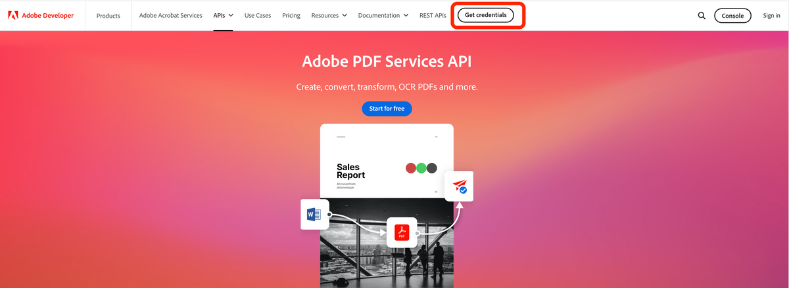
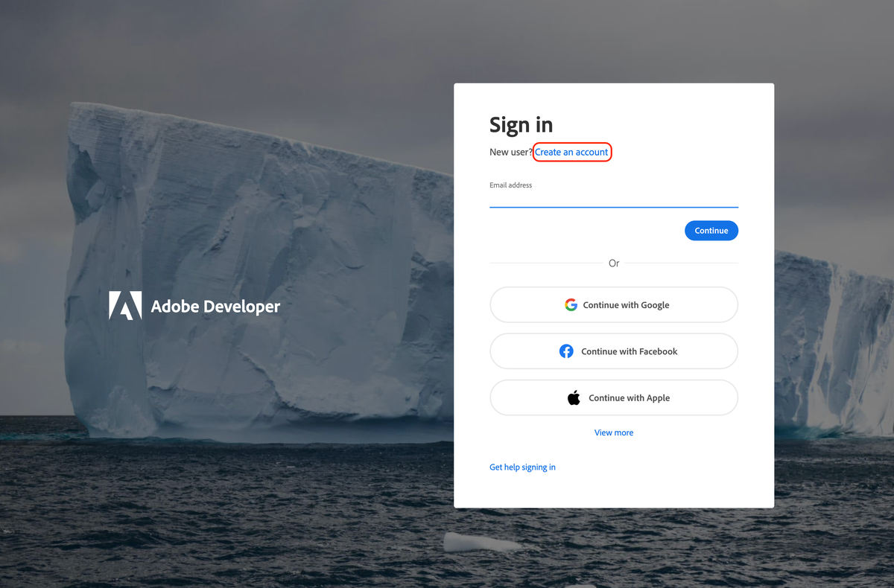
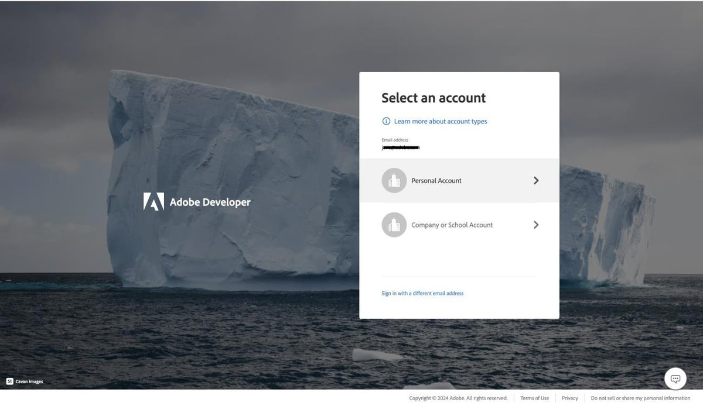
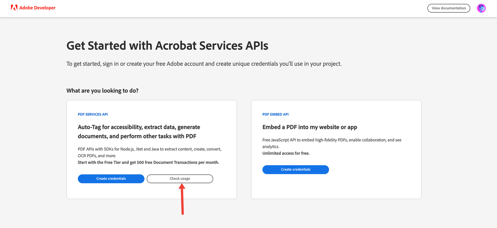

# PDF Tools

Self-hosted web app to **combine** multiple PDFs and **split** a PDF into per-page files (ZIP). Those two flows run **entirely on your server** with [pdf-lib](https://pdf-lib.js.org/)—**no Adobe account, no API key, no outbound PDF cloud calls**. Optional Adobe PDF Services power the rest of the **tool library** (convert, OCR, export, etc.).

TanStack Start app (Vite + Nitro, SSR + hydrated React).

[](LICENSE)

## Requirements

- Node.js 20+
- npm

## Quick start

```bash
npm install
cp .env.example .env   # optional
npm run dev
```

Open **http://localhost:3000** (or the port in your `.env`, e.g. **5000** if `PORT=5000`).

You can use **`/combine` and `/split` immediately** after `npm install`—leave `PDF_SERVICES_*` empty in `.env`.

| Route | API needed? | Description |
|-------|-------------|-------------|
| `/` | No | Home |
| `/combine` | **No — local only** | Merge PDFs on your server → download one PDF ([pdf-lib](https://pdf-lib.js.org/)) |
| `/split` | **No — local only** | Split PDF into pages on your server → download ZIP |
| `/library` | No to browse; Adobe tools need credentials | Searchable catalog (`/help` redirects here) |
| `/tools/:id` | **Yes** (Adobe) | Cloud PDF Services operation (export, OCR, etc.) |

### Local combine & split (no setup)

| | |
|---|---|
| **Runs on** | Your machine / your deployed server only |
| **Library** | `pdf-lib` in a TanStack Start server function |
| **Adobe** | Not used — files are not sent to Adobe |
| **`.env`** | Optional (upload limits, `PORT` only). **Do not need** `PDF_SERVICES_CLIENT_ID` / `PDF_SERVICES_CLIENT_SECRET` |

Files are uploaded to temp storage on the server, processed in memory/disk locally, streamed back to the browser, then deleted (see [Privacy](#privacy)).

Production:

```bash
npm run build
npm start   # node .output/server/index.mjs
```

### Docker (one command)

**Combine and split work with no Adobe keys**—use an empty `.env.docker` or leave `PDF_SERVICES_*` blank. Add Adobe credentials only if you need **`/library`** cloud tools.

```bash
cp .env.docker.example .env.docker   # edit optional Adobe vars & limits
docker compose up --build -d
```

Open **http://localhost:3000** (or set `PUBLISH_PORT=8080` in your shell to map another host port).

| Variable (in `.env.docker`) | Purpose |
|-----------------------------|---------|
| `PDF_SERVICES_CLIENT_ID` / `PDF_SERVICES_CLIENT_SECRET` | Optional — Adobe library tools only |
| `MAX_FILE_SIZE_MB`, `MAX_FILES` | Upload limits (defaults 50 / 20) |
| `PUBLISH_PORT` | Host port mapped to the container (Compose, default `3000`) |

Stop: `docker compose down`

## Adobe PDF Services credentials (optional, library only)

> **Skip this section** if you only need **`/combine`** and **`/split`**. Those routes never read `PDF_SERVICES_*` and never call Adobe.

To run tools under **`/library` → `/tools/:id`**, add credentials so the server can call [Adobe PDF Services](https://developer.adobe.com/document-services/docs/overview/) on your behalf (Adobe’s cloud processes those jobs).

Adobe’s **free tier** includes **500 document transactions per month** (see [overview](https://developer.adobe.com/document-services/docs/overview/) and [FAQ](https://developer.adobe.com/document-services/docs/overview/faq)). You do not paste an API key into the browser—only server-side env vars.

### 1. Create credentials

1. Sign in with an [Adobe ID](https://account.adobe.com/) (personal account is easiest; work/school accounts may need the [FAQ workflow](https://developer.adobe.com/document-services/docs/overview/faq)).
2. Open Adobe’s credential flow: **[Get credentials (PDF Services API)](https://developer.adobe.com/document-services/docs/overview/pdf-services-api/gettingstarted/)** — use the **Get credentials** / **click here** link on that page, or start from **[Start modifying PDFs](https://developer.adobe.com/document-services/apis/pdf-services/start-modifying-pdf/)**.
3. Choose **PDF Services API**, name your project, and create credentials.
4. Download the zip; it includes **`pdfservices-api-credentials.json`**.

On the Adobe developer site, use **Get credentials** (free tier includes **500 document transactions/month**):



*Screenshot from [Adobe PDF Services FAQ](https://developer.adobe.com/document-services/docs/overview/faq/). UI may differ slightly over time.*

**Work or school email?** If Adobe says you don’t have access, sign out and create a **Personal account** with your work email ([FAQ steps](https://developer.adobe.com/document-services/docs/overview/faq)):

| Create account | Choose Personal account |
|----------------|-------------------------|
|  |  |

### 2. Add values to `.env`

From `pdfservices-api-credentials.json`, copy **`client_id`** and **`client_secret`** from `client_credentials` into your repo root `.env` (see `.env.example`):

```env
PDF_SERVICES_CLIENT_ID=your_client_id_here
PDF_SERVICES_CLIENT_SECRET=your_client_secret_here
```

Prefer **`.env.local`** for secrets on your machine (gitignored). Restart **`npm run dev`** after changing env vars.

### 3. Confirm in the app

Open **`/library`** and run an Adobe tool (e.g. export or combine with page ranges). If credentials are missing, the tool page shows a banner; if they are wrong or quota is exhausted, the run will fail with an Adobe error message.

Usage reports: open the same credential portal and click **Check Usage**:



([Getting started — check usage](https://developer.adobe.com/document-services/docs/overview/pdf-services-api/gettingstarted/))

Screenshots in [`docs/adobe/`](docs/adobe/ATTRIBUTION.md) are from Adobe’s official documentation; see [attribution](docs/adobe/ATTRIBUTION.md).

## Configuration

Copy `.env.example` to `.env` (and optionally `.env.local` for secrets).

| Variable | Default | Description |
|----------|---------|-------------|
| `MAX_FILE_SIZE_MB` | `50` | Max size per uploaded file |
| `MAX_FILES` | `20` | Max PDFs per combine request |
| `PORT` | dev: `3000` (override in `.env`, e.g. `5000`) | Nitro production listens on `PORT` |
| `PDF_SERVICES_CLIENT_ID` | *(empty)* | **Optional.** Only for **`/tools/*`** Adobe library tools—not for `/combine` or `/split` |
| `PDF_SERVICES_CLIENT_SECRET` | *(empty)* | **Optional.** Same as above |

See [Adobe PDF Services credentials (optional, library only)](#adobe-pdf-services-credentials-optional-library-only) if you use the library’s Adobe tools.

## Project structure

```
pdf-tools/
├── src/                 # TanStack Start (routes, components, server fns)
├── public/              # static assets
├── docs/adobe/          # README screenshots (Adobe attribution)
└── tmp/                 # runtime uploads (gitignored; not in repo)
```

Local-only folders (`unrelated/`, `v1/`, `tmp/`, `.env*`) are **gitignored** and not part of the published repo.

## Privacy

Web uploads live under `tmp/<uuid>/`, are processed on the server, streamed to the browser, then deleted. `tmp/` is never served as static files. Personal files under `unrelated/` are separate from the app.

## License

[ISC](LICENSE)
